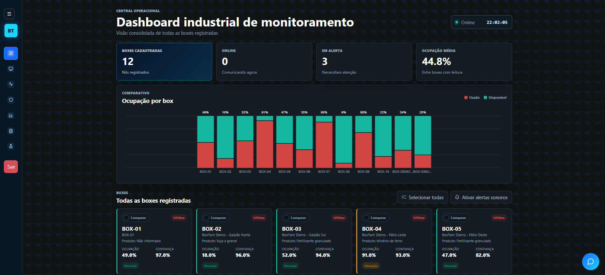
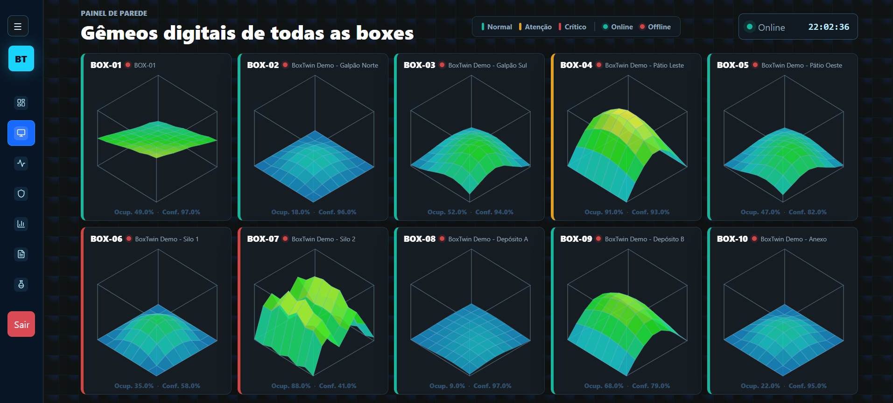
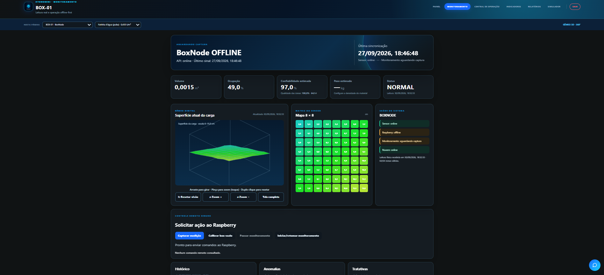
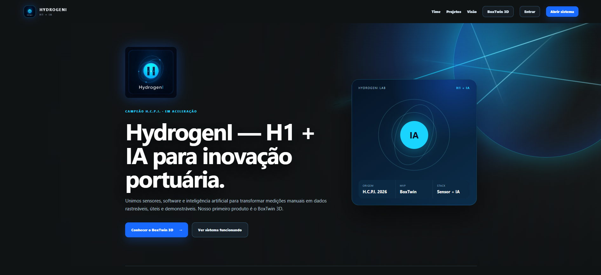

# HydrogenI — BoxTwin 3D

> Gêmeo digital para apoiar a medição de volume de fertilizantes armazenados em boxes portuários.

🏆 Projeto vencedor do Desafio 3 do II Hackathon do Complexo Portuário do Itaqui (2026), realizado por EMAP e ICT Guará.

[Ver demonstrador](https://hydrogeni-boxtwin-production.up.railway.app/) · [Abrir simulador](https://hydrogeni-boxtwin-production.up.railway.app/simulador)

> Este é o repositório público de apresentação da equipe HydrogenI. O código do produto é mantido em repositório privado; aqui reunimos o contexto, a arquitetura e as entregas coletivas.

## O desafio

O acompanhamento de fertilizantes a granel em boxes portuários pode depender de estimativas visuais e contagens manuais. Isso reduz a rastreabilidade do inventário e exige inspeções frequentes.

## A resposta do time

O BoxTwin 3D transforma leituras de profundidade em uma representação operacional da carga. A solução foi concebida para funcionar tanto em demonstração quanto junto ao equipamento de campo, preservando leituras locais em indisponibilidades de conexão.

```text
Sensor ToF 8×8
      ↓
Raspberry Pi / processamento local
      ↓
Cálculo de superfície, volume e ocupação
      ↓
SQLite + fila offline ── sincronização ──→ plataforma central
                                              ↓
                           painéis · alertas · relatórios · demonstrador
```

## Entregas coletivas

| Frente | O que a equipe construiu |
| --- | --- |
| Produto e operação | Fluxos para acompanhar boxes, alertas, tratativas e relatórios. |
| Gêmeo digital | Visualização 3D da carga, mapa de alturas e indicadores de volume, ocupação e peso estimado. |
| Hardware e edge | Integração preparada para Raspberry Pi e sensor ToF VL53L8CX, com processamento local. |
| Confiabilidade | Persistência local, fila de sincronização idempotente e operação possível sem internet. |
| Demonstração | Simulador público separado de dados reais, cenários de carga e dados de apresentação. |
| Qualidade e entrega | Testes automatizados, integração contínua e implantação da plataforma. |
| Comunicação e validação | Pesquisa de mercado, organização da jornada, protótipo físico e apresentação à banca. |

## Capacidades do demonstrador

- Gêmeo digital 3D e grade de leituras do sensor.
- Estimativas de volume, ocupação, altura e peso por material.
- Painel geral e painel de parede para operação.
- Alertas de capacidade, confiança do sensor e possível obstrução.
- Histórico de leituras, confirmações e tratativas humanas.
- Relatórios operacionais em PDF e Excel.
- Interface responsiva, PWA e modo de demonstração.

## Telas do produto

| Visão geral das boxes | Painel de parede |
| --- | --- |
|  |  |

| Monitoramento de uma box | Página pública do HydrogenI |
| --- | --- |
|  |  |

## Arquitetura tecnológica

| Camada | Tecnologias e componentes |
| --- | --- |
| Sensoriamento | Sensor ToF VL53L8CX, matriz 8×8 |
| Edge | Raspberry Pi, processamento local e SQLite |
| Plataforma | Python, Flask, Gunicorn e SQLite |
| Interface | HTML, CSS e JavaScript |
| Integrações | E-mail, WhatsApp, IA assistiva e relatórios |
| Entrega | GitHub Actions, Railway e serviços systemd |

## Time HydrogenI

O BoxTwin é resultado de trabalho colaborativo que reuniu desenvolvimento, arquitetura, interface, pesquisa, prototipagem, operações e apresentação. Cada integrante participou da construção e evolução da solução.

### Domingos Junior

[GitHub](https://github.com/JuniorDdev) · [E-mail](mailto:junior.db2008@gmail.com) · [LinkedIn](https://www.linkedin.com/in/domingos-junior-7a5357252/)

### Fernando Harrison

[GitHub](https://github.com/Fernando-Harrison) · [E-mail](mailto:fernandoharrison33@gmail.com) · [LinkedIn](https://www.linkedin.com/in/fernando-harrison-431a6a324/)

### Geovane Paixão

[GitHub](https://github.com/Geovannehh) · [E-mail](mailto:eng.geovanepaixao@gmail.com) · [LinkedIn](https://www.linkedin.com/in/geovane-paix%C3%A3o/)

### Luís Hyerro

[GitHub](https://github.com/LuisHyerro) · [E-mail](mailto:luishyerro0@gmail.com) · [LinkedIn](https://www.linkedin.com/in/luis-hy%C3%AArro-b6407a250/)

### Mateus Mendes

[GitHub](https://github.com/mateusmendess) · [E-mail](mailto:mateusxmendes@gmail.com) · [LinkedIn](https://www.linkedin.com/in/mateus-mendes-730789237/)

## Próximos passos

- Validar a medição em bancada e em campo com volumes conhecidos.
- Preparar o monitoramento das baias do piloto.
- Acompanhar métricas de precisão, disponibilidade e impacto operacional.

## Contato

Para demonstrações, parcerias ou informações sobre o projeto, entre em contato com a equipe HydrogenI pelos canais institucionais divulgados pela organização.
